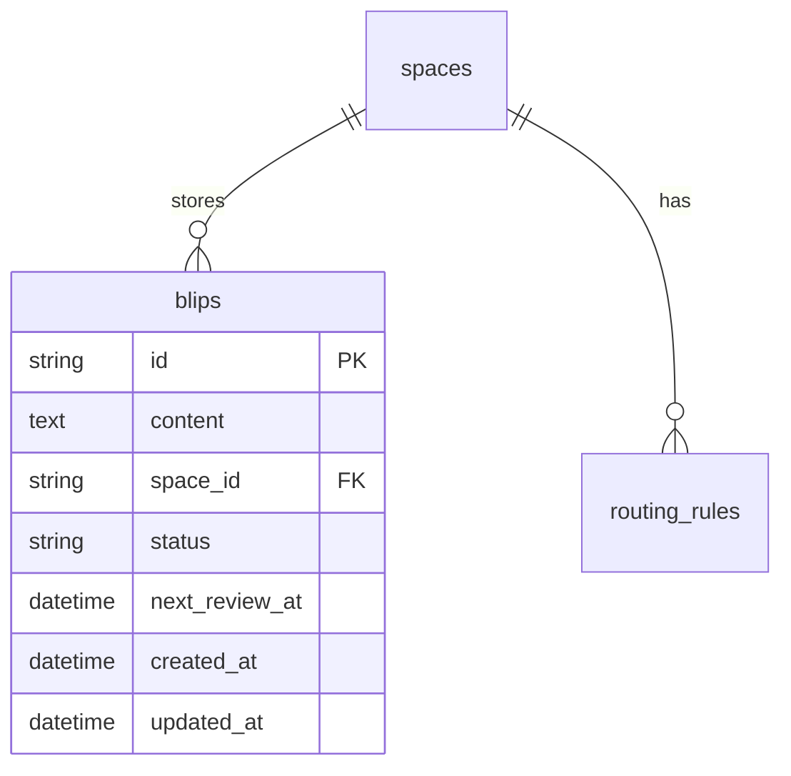

# Data model

Tables: `blips`, `blip_groups`, `spaces`, `book_details`, `repo_details`, `routing_rules`, `routing_events`, `app_settings`. (`categories` was removed in migration 0007; spaces replaced it.) The canonical schema is in `src/db/schema.ts` (Drizzle).

## Tables

### blips

| Column         | Type    | Constraints                  | Description                                    |
| -------------- | ------- | ---------------------------- | ---------------------------------------------- |
| id             | text    | PK                           | UUID                                           |
| content        | text    | NOT NULL                     | Blip body                                      |
| status         | text    | NOT NULL, default `active`   | `active` \| `matured` \| `fizzled`             |
| next_review_at | integer | nullable                     | Timestamp (mode: timestamp); when to resurface |
| created_at     | integer | NOT NULL                     | Timestamp                                      |
| updated_at     | integer | NOT NULL                     | Timestamp                                      |

- **status:** `active` = in feed/cultivation; `matured` = graduated; `fizzled` = terminal, no longer shown in feed.
- **next_review_at:** Used for feed: “due” when `next_review_at <= today` or null. Snooze sets this to a future date; feed blips snoozed past today are listed (and can be unsnoozed) at `/spaces/snoozed`.

### blips: link-card columns

Populated by the markdown import on the Capture page; all nullable (null for plain blips): `title`, `summary`, `image_url`, `url`, `site_name`, and `group_id` (FK → `blip_groups.id`).

### blip_groups

`id` (PK), `label` (topic name, e.g. "Nvidia Leadership"), `created_at`. Blips sharing a `group_id` render together in the feed.

### app_settings

Key/value store (`key` PK, `value`). Holds `ai.provider` and `ai.model.<provider>`. API keys are NOT stored here; they come from env vars.

### spaces.kind

`general` | `video` | `book` | `code`. Specialized kinds change how the space page renders and add deterministic routing (video, book and repository links). A general space can be converted to `book` or `code` (one-way); see [discovery/book-space.md](discovery/book-space.md) and [discovery/code-space.md](discovery/code-space.md).

### book_details

1:1 with a blip in a book space: `blip_id` (PK, FK -> `blips.id`, cascade delete), `isbn13`, `authors` (JSON array of names), `publisher`, `published_year`, `page_count`, `lookup_status` (`ok` = exact ISBN match, `partial` = matched by title, `failed` = no usable match), `fetched_at`. The cover is `blips.image_url` and the title `blips.title`. No row means "never looked up". Price is not stored (stretch goal).

### repo_details

1:1 with a blip in a code space (migration 0010): `blip_id` (PK, FK -> `blips.id`, cascade delete), `provider` (`github` | `gitlab` | `bitbucket` | `codeberg` | `sourcehut`), `owner`, `name`, `description`, `stars`, `language`, `topics` (JSON array), `license`, `homepage`, `pushed_at`, `archived`, `lookup_status` (`ok` | `failed`), `fetched_at`. No row means "never looked up" (or the host was unavailable and the lookup is deferred). The blip's title, image and link are not changed by a lookup.

### routing_rules

`id` (PK), `pattern` (unique; normalized `host[/path]`, e.g. `github.com/vercel`), `space_id` (FK → `spaces.id`, NOT NULL), `created_at`. Links whose host (or subdomain) and optional path prefix match go to the space, ahead of every other routing step. Rules are deleted with their space.

## Relationships

- **spaces → routing_rules:** one space has many rules (`space_id` FK).

## ER (conceptual)

## Migrations

- Generated with: `npm run db:generate`
- Applied with: `npm run db:migrate`

Additional `app_settings` keys: `ai.instructions` (extra prompt text appended to the built-in system prompt) and `ai.options` (JSON: temperature, topP, maxOutputTokens, frequencyPenalty, presencePenalty; absent fields use provider defaults).

## Spaces

- **spaces:** `id`, `name`, `description`, `kind` (`general` | `video` | `book` | `code`, default `general`), `auto_intake` (boolean), `ai_routing` (boolean, default true; when false the AI never routes new links here), `created_at`. A `video` space renders a tiled player grid and receives YouTube links automatically; see [discovery/video-space.md](discovery/video-space.md).
- **blips.space_id** (nullable FK): a stored blip. Blips with a `space_id` are excluded from the feed.
- **blips.routed_by** (nullable: `rule` | `group` | `ai`): how a blip was auto-routed into its space at capture; null when stored by hand. See [discovery/inbox-routing.md](discovery/inbox-routing.md).
- **blips.routed_reason** (nullable text): why the blip was auto-routed; cleared with `routed_by`.
- **routing_events:** audit log of capture/reprocess routing decisions: `id`, `blip_id`, `blip_title`, `url`, `space_id`, `space_name` (null = stayed in the feed), `routed_by` (`rule` | `group` | `ai`, null = no route), `reason`, `source` (`capture` | `reprocess` | `reroute`), `created_at`. No foreign keys, so entries survive deletes and renames. Shown at `/routing`.
- **blip_groups.space_id** (nullable FK): links a topic group to at most one space (a space can have many groups).
- **Auto-intake:** on import/reprocess, a blip whose group is linked to a space with `auto_intake` on is stored in that space. A new group whose label matches a space name (case-insensitive) is linked automatically. Linking a group, creating a same-named space, or turning auto-intake on stores the group's existing unstored blips too.
- Deleting a space returns its blips to the feed and unlinks its groups. Unlinking a group does not evict blips already stored.
